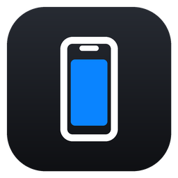

<p align="center"></p>

<h1 align="center">Ipon Mirror</h1>

<p align="center">iPhone の画面を、ケーブルなし・アプリ追加なしで Windows に映すアプリ</p>

---

iPhone のコントロールセンターにある「画面ミラーリング」(AirPlay) をそのまま使います。
iPhone 側には何もインストールする必要がありません。

- **低遅延**: 映像の受信から表示までを GPU (Direct3D 12) で処理
- **枠なしウィンドウ**: iPhone の画面の形にぴったり。回転すると自動で縦横が切り替わる
- **Discord などの画面共有に対応**: 「アプリ」一覧から映像ウィンドウを選べる
- **PC 側で音量調節**: スライダー / ミュート / ↑↓キー (iPhone の音量ボタンも使えます)
- **無料・時間制限なし・広告なし**

## 使い方

1. [Releases](../../releases) から `IponMirror-x.y.z-win64.zip` をダウンロードして展開
2. `IponMirror.exe` を起動
   - 初回は Windows のファイアウォール確認が出ることがあります。**プライベートネットワークを許可**してください
3. iPhone を PC と**同じ Wi-Fi / ルーター**につなぐ
4. iPhone のコントロールセンター →「画面ミラーリング」→「Ipon Mirror」を選ぶ

### 映像ウィンドウの操作

| 操作 | 動作 |
|---|---|
| ドラッグ | 移動 |
| マウスホイール | 拡大・縮小 |
| ダブルクリック | 全画面 / 元に戻す (Esc でも戻る) |
| ↑ / ↓ | 音量を上げる / 下げる |
| M | ミュート切替 |
| 右クリック | メニュー (常に手前に表示 など) |
| 右上の ✕ (マウスを動かすと表示) | ミラーリングを終了 |

### 一覧に出てこないとき

- PC と iPhone が同じネットワークにあるか (ゲスト Wi-Fi やプライバシーセパレーターが有効だと見えません)
- Windows のネットワークが「パブリック」の場合、ファイアウォールで `uxplay.exe` が許可されているか
- 他の AirPlay 受信アプリを閉じる

ログは `%LOCALAPPDATA%\IponMirror\engine.log` に保存されます。

## 動作環境

- Windows 10 / 11 (64bit)
- Direct3D 12 対応 GPU 推奨 (非対応の場合は自動でソフトウェア処理に切り替わります)
- iOS / iPadOS の画面ミラーリング (AirPlay)

## 仕組み

AirPlay の受信には [UxPlay](https://github.com/FDH2/UxPlay) を使っています。
Ipon Mirror は UxPlay を起動・管理する GUI と、映像ウィンドウを枠なしで扱う部分を担当します。
UxPlay には小さな改造 ([engine/uxplay-ipon.patch](engine/uxplay-ipon.patch)) を加えています。

- 画面サイズが変わる (回転する) たびにログに出す
- 接続が全部切れたときにログに出す
- 出力をバッファリングしない (GUI にすぐ届けるため)

## ソースからビルド

必要なもの: Windows 10/11, Python 3.11 以上 (tkinter 付き), git

```powershell
# 1. 受信エンジン (UxPlay) をビルド。MSYS2 が無ければ winget で入れます
powershell -ExecutionPolicy Bypass -File scripts\build_engine.ps1

# 2. そのまま動かす (開発用)
py app\ipon_mirror.py

# 3. 配布用 zip を作る (PyInstaller が必要: py -m pip install pyinstaller)
py scripts\package.py
```

## ライセンス

[GPL-3.0](LICENSE)。UxPlay (GPL-3.0) を利用しているため、このプロジェクトも GPL-3.0 です。
配布 zip には GStreamer / FFmpeg などの MSYS2 パッケージが同梱されており、
それぞれのライセンスは zip 内の `licenses/` に入っています。

iPhone、AirPlay は Apple Inc. の商標です。このプロジェクトは Apple とは関係ありません。
